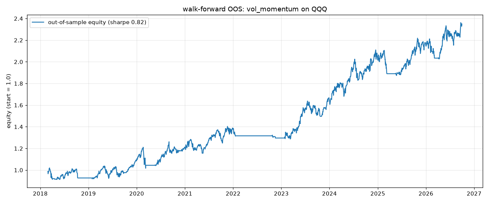

# quantlab — Multi-Market Strategy Backtesting & Research Engine

**A Python research engine for testing trading strategies across US equities, crypto, and Polymarket prediction markets — built around walk-forward out-of-sample validation, because the point is to *reject* overfit strategies, not to produce pretty in-sample equity curves.**

Most backtesting toys will happily show you a 300% return that evaporates the moment you trade it. This one is designed to catch that: every result is charged realistic costs, every signal trades at the *next* bar's open, the headline number is out-of-sample, and it comes with error bars.



## Why this project exists

Backtests lie in a handful of common ways. quantlab is built to close each hole:

| Failure mode | How the engine prevents it |
|---|---|
| **Look-ahead bias** — trading on a signal at the same bar it appears | A signal computed at bar *t*'s close is traded at bar *t+1*'s **open**, so it never buys the price that produced it. An overnight gap after the signal belongs to the position held before it. (`--fill close` reproduces the older fill at the signal bar's close, for comparison) |
| **Ignoring frictions** — costless backtests that die on real fees | Fee and slippage charged on turnover, with named venue presets (`--venue coinbase_advanced` costs 0.60% a fill, `okx_perp` 0.05%). Optional perpetual funding (`--perp`, OKX history) and short borrow (`--borrow-rate`) |
| **Overfitting** — tuning parameters until the past looks great | Anchored walk-forward: parameters are optimized on a training window, then traded **unchanged** on data the optimizer never saw. Only the stitched out-of-sample equity counts |
| **One number, no error bars** — a Sharpe from a few dozen trades | `walkforward` reports a block-bootstrap 95% interval for the Sharpe, the years of data it would take to be significant, and a **signal-quality gate** on the out-of-sample trades: trimmed mean, median, t-statistic, and how much of the P&L the best 5% of trades earned |
| **Lucky picks** — ranking many configurations and believing the top one | `scan` is labelled in-sample, and `--control N` scores each strategy against N copies of itself with randomly shifted timing: same exposure and turnover, no timing. If the real one doesn't beat most of them, its signal selects nothing |
| **Not knowing your data** — a silent fallback to another source | Every result names its data source. Binance blocks US addresses (HTTP 451) and the crypto loader used to fall back to Yahoo silently; it now says so, and caches by source |

Every strategy is also scored against a **buy-and-hold benchmark** on the same asset. A strategy that can't beat holding the asset isn't a strategy.

## Architecture

```
quantlab/
├── data/          yfinance (equities), crypto, Polymarket CLOB, OKX funding; on-disk caching
├── engine/        vectorized backtester, metrics, venue cost presets
├── research/      grid search, anchored walk-forward, bootstrap error bars,
│                  random-timing control, signal-quality gate
├── forward/       frozen-rule forward ledgers (see "Forward record")
├── strategies/    9 strategies behind one Strategy interface + registry
└── report.py      matplotlib equity/drawdown/position charts
main.py            CLI: backtest · scan · optimize · walkforward · pm-search
experiments/       standalone research studies (see below)
```

Strategies implement one method — `generate_positions(prices) -> Series` in `[-1, 1]` — and declare a `param_grid`. Registering a new strategy in `strategies/__init__.py` makes it automatically available to the optimizer, the scanner, and walk-forward validation. No changes to the engine.

## Metrics reported

Total return · CAGR · **Sharpe** · Sortino · **max drawdown** · Calmar · win rate · profit factor · trade count — for both the strategy and the buy-and-hold benchmark. Sortino divides by the downside deviation over *every* period, flat days included.

## The five commands

```bash
# 1. Backtest one strategy, net of fees and slippage, vs buy & hold
python main.py backtest --market crypto --symbol BTC-USD --strategy sma_cross
python main.py backtest --market stock --symbol AAPL --strategy rsi_reversion --params window=14,lower=30

python main.py backtest --market crypto --symbol ETH-USD --strategy sma_cross --perp --venue okx_perp

# 2. Sweep many symbols x many strategies to find where signal might exist (in-sample)
python main.py scan --market stock --symbols QQQ,SPY,NVDA,TSLA --control 100

# 3. Grid-search one strategy's parameters (in-sample)
python main.py optimize --market crypto --symbol ETH-USD --strategy momentum

# 4. Walk-forward out-of-sample validation  <-- the one that matters
python main.py walkforward --market stock --symbol QQQ --strategy sma_cross

# 5. Search Polymarket for a market, then backtest its YES token
python main.py pm-search --query "fed"
python main.py backtest --market polymarket --symbol <yes_token_id> --strategy momentum
```

`walkforward` reports **in-sample vs out-of-sample Sharpe per fold**, which is the fastest way to see overfitting: a strategy whose IS Sharpe is 2.5 and OOS Sharpe is 0.1 has been curve-fit, not discovered. It then puts error bars on the stitched result and runs the signal-quality gate (`research/signal_quality.py`) on the out-of-sample trades.

The gate's thresholds are fixed before any result is seen. It was written for arbitrage-style signals, which should win most of the time; trend following deliberately loses small and often and earns from a few large trends, so it can fail the median and concentration checks by design. A failure is a statement about the shape of the returns to read, not a verdict to override.

## Built-in strategies

| Name | Type | Logic |
|---|---|---|
| `buy_hold` | Benchmark | Always long — the bar every other strategy must clear |
| `sma_cross` | Trend | Long when the fast moving average is above the slow one |
| `momentum` | Momentum | Long when trailing N-bar return is positive |
| `rsi_reversion` | Mean reversion | Buy oversold RSI, exit on recovery |
| `bollinger` | Mean reversion | Buy below the lower band, exit at the middle band |
| `vol_momentum` | Momentum + risk control | Long on positive momentum, sized as target vol ÷ realized vol (higher volatility → smaller position) |
| `donchian` | Breakout | Enter on an N-bar high, exit on an M-bar low (turtle-style) |
| `trend_vol` | Trend + risk control | Long above the 200-day average, sized to a volatility target |
| `rsi2` | Mean reversion | Connors RSI(2): buy a short-term dip in an uptrend, sell above the 5-day average |

## Research experiments (`experiments/`)

Standalone studies that use the engine rather than extend it:

- **`portfolio_2026.py`** — a 50/50 QQQ + BTC volatility-targeted momentum portfolio, scored **only on walk-forward out-of-sample returns**
- **`polymarket_favorite_bias.py`** — tests the favorite–longshot bias on *resolved* Polymarket markets, entering at actual trades and splitting fresh from stale prices. Verdict: no bias at tradeable prices; the apparent edges on both ends live in stale prints
- **`crypto_rotation.py`** — weekly top-N momentum rotation across altcoins, with an honest split: parameters chosen on pre-2023 data, validated on 2024+
- **`leverage_sweep.py`** — sweeps 1x–4x leverage over already-validated out-of-sample returns to show the return/drawdown tradeoff

## Forward record (`forward/`)

A backtest can be fit to the past; a record kept after the rules were frozen cannot. Three rule sets trade forward every day ([summary](forward/README.md)):

| Ledger | Rules |
|---|---|
| `portfolio_2026` | The case study: 50/50 QQQ and BTC, volatility-targeted momentum |
| `trend_crypto` | Thirds of BTC, ETH, SOL; held above the 200-day average, sized to a 20% vol target (`trend_vol`) |
| `rsi2_etf` | Halves of SPY and QQQ; Connors RSI(2) below 10 above the 200-day average, out above the prior 5-day average (`rsi2`) |

The last two moved here from a sibling project's ledgers; `tests/test_ported_strategies.py` checks them bar for bar against a transcription of the original code.

- **Frozen rules** in [`forward/specs/`](forward/specs/). Their hash is locked when a ledger starts, and the ledger refuses to run if the rules change; new rules get a new name and a new ledger.
- **Daily, on GitHub Actions** ([`forward.yml`](.github/workflows/forward.yml), 01:17 UTC with a 13:43 UTC backup, since GitHub can drop a scheduled run): run the tests, record each newly completed bar (fill at the open, mark at the close, with the backtester's own per-bar formula), reconcile, commit. Ledgers live in [`forward/ledgers/`](forward/ledgers/). A ledger whose download fails writes nothing and catches up the next day; the others are still recorded.
- **Append-only**, and the git history timestamps every row: `git log -p forward/ledgers` shows when each day was written. Days caught up after a missed run are marked `recorded_late`.
- **Reconciled every run**: each row must follow exactly from the previous one and its recorded prices, and the backtester replaying the same bars on fresh data must agree with the ledger.

```bash
python main.py forward run         # record new completed bars, every spec
python main.py forward reconcile   # check each ledger against itself and the engine
python main.py forward status      # summaries (--spec for one)
```

## Setup

```bash
python -m venv venv
venv/Scripts/pip install -r requirements.txt   # Windows
python main.py --help
```

Dependencies are deliberately small: `pandas`, `numpy`, `matplotlib`, `yfinance`, `requests`.

## Adding a strategy

```python
# quantlab/strategies/my_strategy.py
class MyStrategy(Strategy):
    param_grid = {"window": [10, 20, 50]}

    def generate_positions(self, prices: pd.DataFrame) -> pd.Series:
        ...  # return a Series in [-1, 1]
```

Register it in `strategies/__init__.py` and the optimizer, scanner, and walk-forward runner pick it up automatically.

## Honest limitations

- Backtests charge a flat fee and slippage per venue; they do **not** model market impact or partial fills. Short borrow is a flat annual rate you supply.
- OKX serves only about three months of funding history, so `--perp` charges nothing before that and says how much of the backtest it covered.
- Equity data comes from `yfinance`; crypto from Binance where reachable, else Yahoo (each result says which). Survivorship bias is not corrected for.
- Polymarket price history is a last-trade series with no bid-ask spread, and thin markets print stale prices; the CLI warns on every Polymarket run. Treat those results as directional at best.
- **Historical performance does not predict future returns.** This is a research tool, not investment advice.

## Why I built it

I wanted a place to test market ideas where the default answer is "no." Most of what I've run through it does *not* survive walk-forward validation — which is the point. The engine's job is to make that verdict cheap and fast to reach.
